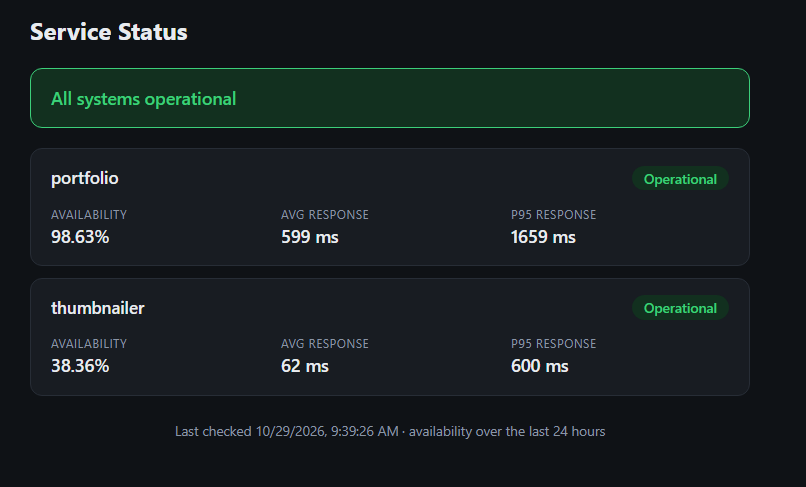
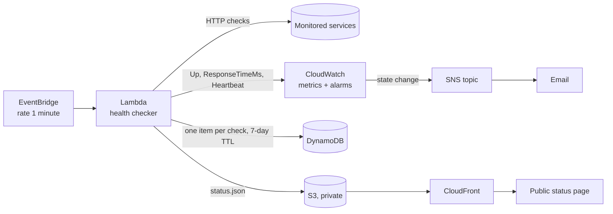
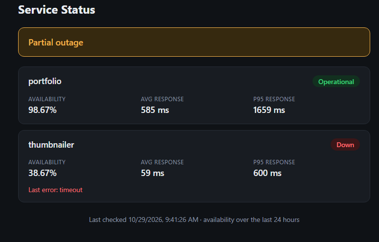
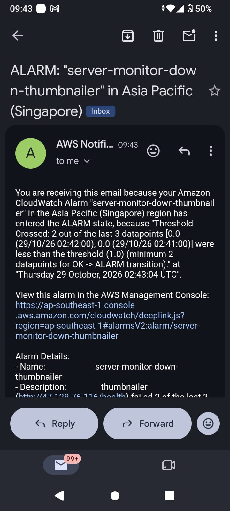

# Server Status Monitor

A small UptimeRobot-style monitoring system built on AWS and deployed entirely with OpenTofu. It checks my own services every minute, emails me within about 3 minutes of an outage, stores 7 days of history, calculates availability per service, and publishes a public status page. It also watches itself with a heartbeat alarm.



## Features

- Checks each target every minute, in parallel (HTTP status, 5-second timeout, DNS/TLS/timeout failures reported separately)
- Email alerts through SNS when a service is down, slow, or when the monitor itself stops
- 7 days of check history in DynamoDB (automatic TTL cleanup)
- Availability, average and p95 response time per target over the last 24 hours (my first SLI)
- Public status page served from S3 through CloudFront
- Everything defined as code with OpenTofu

## Architecture



The Lambda publishes metrics first, so alerting never depends on storage. History and `status.json` are written afterwards, and a storage error is logged without breaking alarms.

## Alerting design

| Alarm | Rule | Missing data |
|---|---|---|
| Down (per target) | `Up` below 1 in 2 of the last 3 checks | Counts as failing |
| High latency (per target) | Average `ResponseTimeMs` above threshold in 3 of the last 5 minutes (default 2000 ms) | Ignored (a down target already has its own alarm) |
| Heartbeat | No `Heartbeat` metric in 2 of the last 3 minutes | Counts as failing |

Why 2 of 3: one failed check can be a network blip, and two in a row is unlikely to be. Treating missing data as failing means that if the checker itself dies, the alarms fire instead of staying quiet.

Alarms send an email on every state change, including recovery.

## Repository layout

```
server-monitor/
├── main.tf            # SNS, IAM, DynamoDB, S3, Lambda, EventBridge, down alarms
├── monitoring.tf      # heartbeat and latency alarms
├── status_page.tf     # CloudFront, bucket policy, page upload
├── variables.tf
├── lambda/checker.py  # health checks, metrics, history, status.json
└── web/index.html     # static status page
```

## Deploy

Requirements: an AWS account, AWS CLI configured, and OpenTofu 1.6 or newer.

1. Create `terraform.tfvars`:
   ```hcl
   alert_email = "you@example.com"
   targets = [
     { name = "portfolio",   url = "https://your-site.example" },
     { name = "thumbnailer", url = "http://your-service.example/health" },
   ]
   ```
   Use `expected_status` on a target when a non-200 response counts as healthy (for example `expected_status = 400` for a validation endpoint).
2. Run `tofu init`, `tofu plan`, then `tofu apply`.
3. Confirm the subscription email from AWS. No alerts arrive until you do.
4. Open the URL from `tofu output status_page_url`. CloudFront takes a few minutes to finish deploying.

To remove everything: `tofu destroy`.

## Outage drill

I stopped the Thumbnailer service on its EC2 instance and measured how long detection took. Times are UTC (my local time, WIB, is UTC+7).

| Event | Time (UTC) |
|---|---|
| Last successful check | 02:40:26 |
| First failed check (timeout) | 02:41:26 |
| Down alarm in ALARM, email received | about 02:43:04 |
| Detection time | about 2 minutes after the first failed check, within the 3-minute target |

Other results from the drill:

- The status page showed a partial outage while the Thumbnailer was down. The portfolio check stayed up the whole time, so one failure did not affect the other targets.
- The status page banner and cards matched the alarm state.
- Recovery: the first successful check came at 02:57:26 and the OK email arrived about 2 minutes later, because the alarm needs 2 good datapoints to clear.




## Lessons learned

- **Stopping and starting an EC2 instance changes its public IP.** The monitor kept timing out until I updated the target URL and re-applied. In production the target should be a stable DNS name (or an Elastic IP), ideally behind HTTPS. For testing, stopping only the service avoids the problem.
- **Alarms only email on a state change.** If an alarm went to ALARM before the SNS subscription was confirmed, no email was sent. `aws cloudwatch set-alarm-state` re-triggers one for testing.
- **The Lambda code and its configuration are separate.** Updating the environment variables in OpenTofu does not update `checker.py`, and the reverse.
- **Credentials.** OpenTofu cannot read AWS CLI browser-login credentials, so a normal IAM access key (or SSO) is needed.

## Cost

Designed to stay inside the AWS free tier: about 43,000 Lambda runs a month, a small provisioned DynamoDB table, a handful of CloudWatch alarms and custom metrics, and low-traffic S3 and CloudFront. Check the AWS billing console for your own account, since free-tier terms vary. The free allowance covers about 10 alarms and 10 custom metrics, so adding more targets can add a few cents a month.

## Limitations and next steps

- Monitor over HTTPS with a real domain, so DNS and certificate failures are covered (the checker already reports `dns_failure` and `tls_failure`)
- Check the response body, not only the status code
- Add a CloudWatch dashboard
- Add a 7-day availability figure (currently 24 hours, to keep DynamoDB reads cheap)
- Add a custom domain for the status page with Route 53
- Monitor from more than one region